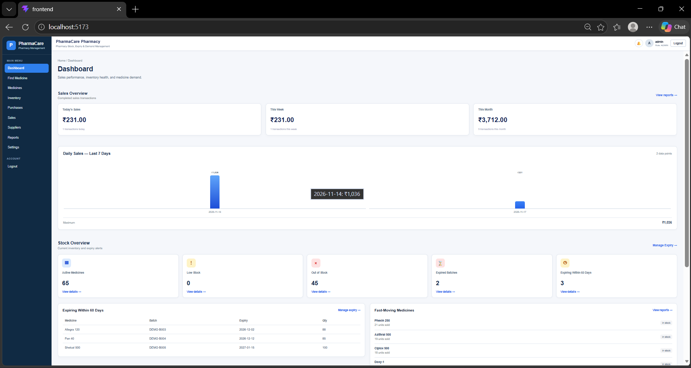
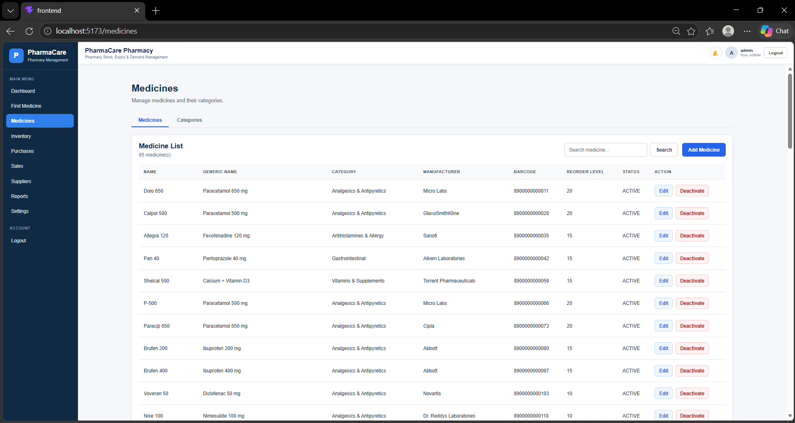
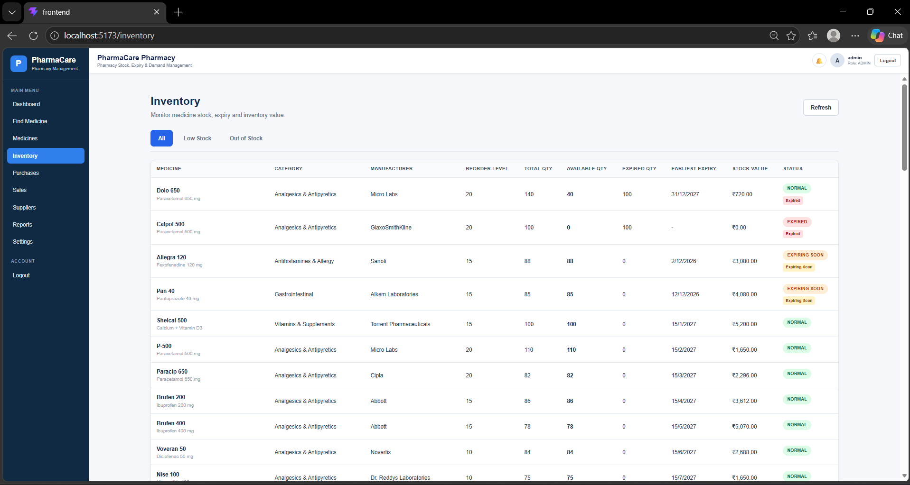
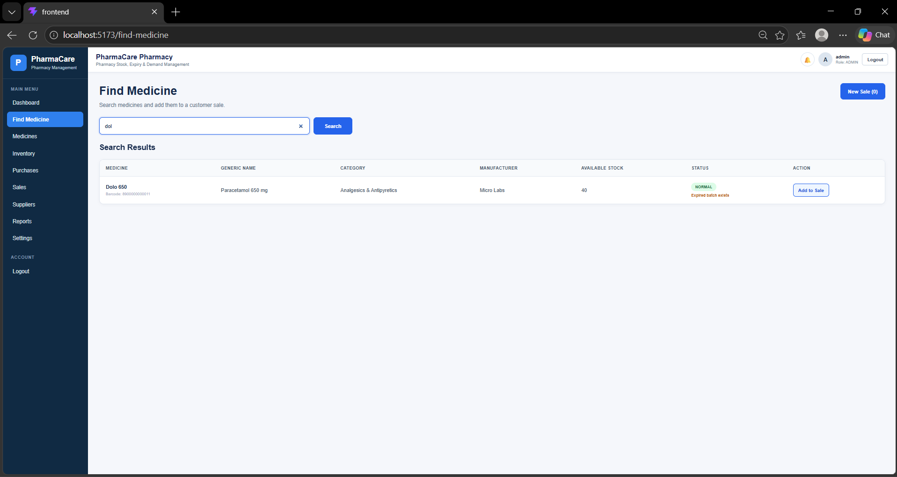
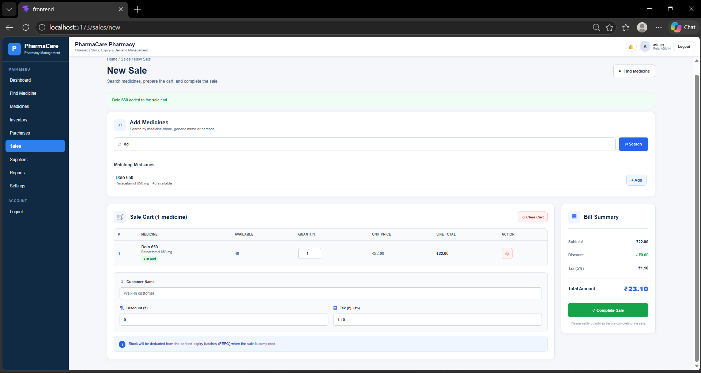
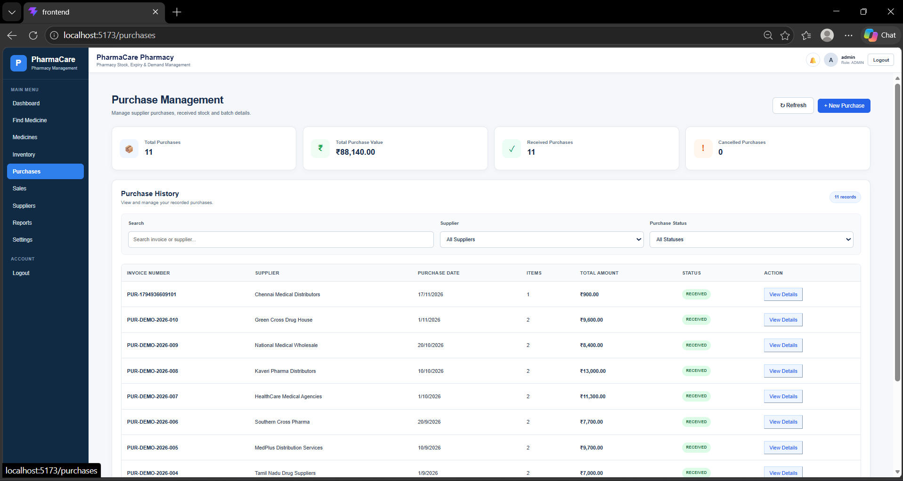
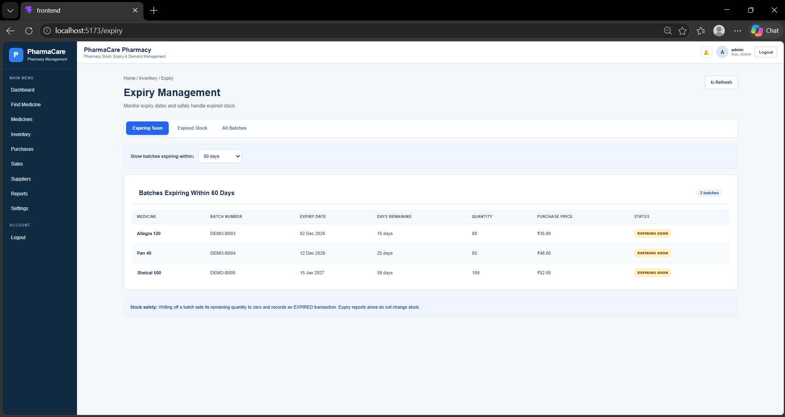
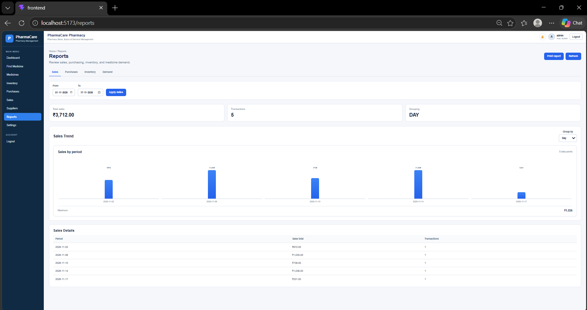

# 💊 PharmaCare – Pharmacy Stock, Expiry & Demand Management System

A full-stack pharmacy management application designed to simplify pharmacy operations through centralized medicine inventory, purchase management, sales tracking, stock monitoring and expiry management.

PharmaCare helps manage pharmacy activities efficiently through a web-based application built with **Java, Spring Boot, React.js and MySQL**.

---

## 📌 Project Overview

PharmaCare is designed to manage essential pharmacy operations in one place. It provides functionality for managing medicines, monitoring available stock, recording purchases and sales, tracking expiry dates and viewing business information through a dashboard and reports.

The application follows a full-stack architecture with a Spring Boot REST API backend and a React.js frontend.


## 📸 Application Screenshots

### Dashboard


### Medicine Management


### Inventory Management


### Find Medicine


### New Sale


### Purchases & Suppliers


### Expiry Management


### Reports



## ✨ Key Features

### 💊 Medicine Management
- Add and manage medicine information.
- Search and view medicine details.
- Maintain medicine records.

### 📦 Inventory Management
- Monitor available medicine stock.
- Track stock levels.
- Identify low-stock medicines.

### 🛒 Purchase Management
- Record medicine purchases.
- Manage supplier information.
- Maintain purchase history.

### 💰 Sales Management
- Create and manage sales transactions.
- Maintain sales history.
- View individual sales details.
- Generate and print sales invoices.

### ⏰ Expiry Management
- Monitor medicine expiry dates.
- Identify medicines nearing expiry.
- View expiry-related alerts.

### 📊 Dashboard & Reports
- View important pharmacy information.
- Monitor inventory alerts.
- Access sales and purchase information.
- Generate reports for pharmacy operations.

### ⚙️ Application Settings
- Manage application configuration.
- Maintain pharmacy-related settings.

---

## 🛠️ Technology Stack

| Layer | Technologies |
|---|---|
| Frontend | React.js, JavaScript, HTML5, CSS3 |
| Backend | Java, Spring Boot |
| API | REST APIs |
| ORM | Hibernate, Spring Data JPA |
| Database | MySQL |
| Build Tool | Maven |
| Development Tools | Eclipse, VS Code |
| API Testing | Postman |
| Version Control | Git, GitHub |

---

## 🏗️ Project Architecture

PharmaCare follows a client-server architecture.

```text
                 PharmaCare
                      |
          +-----------+-----------+
          |                       |
     React Frontend          Spring Boot Backend
          |                       |
          |                  REST APIs
          |                       |
          +---------- HTTP -------+
                                  |
                            Spring Data JPA
                                  |
                               MySQL
```

---

## 📁 Project Structure

```text
pharmacare/
│
├── backend/
│   ├── src/
│   │   ├── main/
│   │   │   ├── java/
│   │   │   └── resources/
│   │   └── test/
│   ├── pom.xml
│   └── .gitignore
│
├── frontend/
│   ├── src/
│   ├── public/
│   ├── package.json
│   └── ...
│
└── README.md
```

---

## ⚙️ Installation & Setup

### Prerequisites

Install the following software before running the application:

- Java JDK
- Apache Maven
- Node.js and npm
- MySQL Server
- Eclipse IDE or another Java IDE
- Visual Studio Code or another React development editor
- Git

### 1. Clone the Repository

```bash
git clone https://github.com/sanjay29-dev/pharmacare.git
cd pharmacare
```

### 2. Configure MySQL Database

Create the database in MySQL:

```sql
CREATE DATABASE pharmacare_db;
```

### 3. Configure Backend

Navigate to the backend directory:

```bash
cd backend
```

Open the following file:

`src/main/resources/application-local.properties.example`

Create a local configuration file named:

`src/main/resources/application-local.properties`

Configure your own MySQL credentials in the local file:

```properties
spring.datasource.url=jdbc:mysql://localhost:3306/pharmacare_db
spring.datasource.username=YOUR_DATABASE_USERNAME
spring.datasource.password=YOUR_DATABASE_PASSWORD
```

**Important:** Keep your actual `application-local.properties` private. Do not upload database passwords or credentials to GitHub.

### 4. Run the Backend

From the backend directory:

```bash
mvn spring-boot:run
```

Backend default port: `8080`

### 5. Run the Frontend

Open another terminal and navigate to the frontend directory:

```bash
cd frontend
npm install
npm run dev
```

Open the local development URL displayed in the terminal.

---

## 🧪 Testing

Backend tests can be executed using Maven:

```bash
cd backend
mvn clean test
```

Frontend production build:

```bash
cd frontend
npm run build
```

Both commands have been executed successfully during project verification.

---

## 🔒 Security

- Local database configuration is excluded from Git tracking.
- Example configuration is provided using placeholder credentials.
- Actual database credentials should be maintained locally.
- Never commit passwords, API keys or other sensitive information.

---

## 🚀 Future Enhancements

- Advanced inventory demand forecasting.
- Enhanced analytics and reporting.
- Additional automation for pharmacy operations.
- Further improvements to user management and security.

---

## 👨‍💻 Developer

**Sanjay V**

Java Full Stack Developer

- GitHub: https://github.com/sanjay29-dev

---

⭐ If you find this project interesting, feel free to explore the repository and its development history.

**PharmaCare – Simplifying Pharmacy Management.**